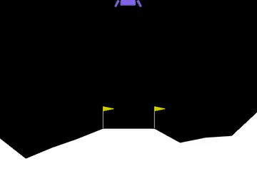
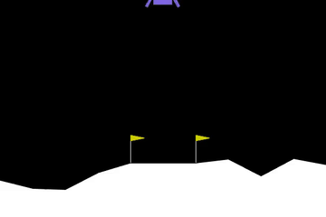
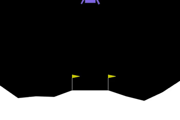
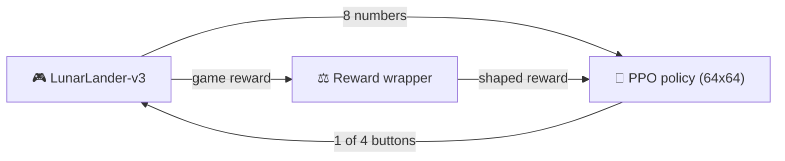
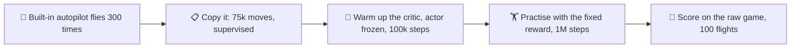
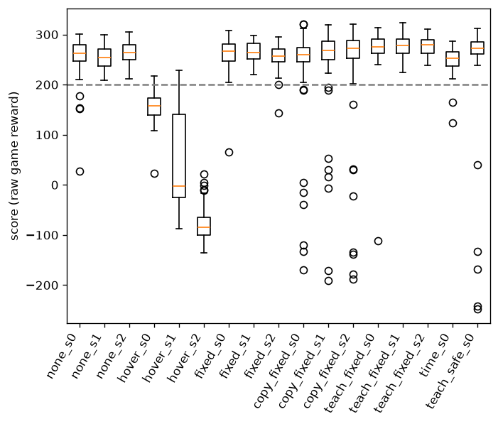

<div align="center">

# 🚀 Rocket-kun

**Teaching a lunar lander to land with reinforcement learning, then breaking its reward on purpose.**


[**TL;DR**](#-tldr) · [**How it works**](#-how-it-works) · [**Results**](#-results) · [**Findings**](#-what-the-numbers-show) · [**Run it**](#-run-it-yourself) · [**FAQ**](#-faq)

<table>
<tr>
<td align="center"><br><b>1. Random buttons</b><br>crashes in 1.5 s</td>
<td align="center"><br><b>2. A gameable reward</b><br>seed 2 never lands (1000 frames)</td>
<td align="center"><br><b>3. Copy a teacher, then practise</b><br>lands in 224 frames (4.5 s)</td>
</tr>
</table>

</div>

## ⚡ TL;DR

This is a small reinforcement-learning study on Gymnasium's `LunarLander-v3`, run on a CPU-only laptop. It asks two questions.

1. **What happens if you add a reward rule that can be exploited?** The rocket learns to farm the bonus instead of landing. Whether it hovers forever or just lands late depends on the training seed.
2. **Does copying a hand-written autopilot first beat learning from scratch?** Yes, on speed: about **30% fewer frames per landing** and about 14 more points, in all 3 seeds. Reliability is no better, because self-learning already reaches the 200-point "solved" bar about 99% of the time.

> Every score here is the **raw game reward** with my reward wrapper switched off, averaged over **100 fresh flights**, for **3 training seeds** per setup.

## 🧠 How it works

The game hands the AI 8 numbers each frame (position, speed, tilt, leg contact), and the AI presses 1 of 4 buttons. A **reward wrapper** sits in the middle and edits the points before the AI sees them. That wrapper is where the experiments live.



The **teacher** experiment adds a head start before the normal practice:



<details>
<summary><b>🎛️ The reward rules (click to expand)</b></summary>

| Mode | Rule |
|---|---|
| `none` | the game's built-in reward only |
| `time` | a small fee of 0.01 per frame |
| `hover` | **+1 per frame** while the rocket is upright and slow, the exploitable rule |
| `fixed` | pay for *becoming* upright and slow, plus the 0.01 fee, the fix |
| `safe` | `fixed`, plus an extra −200 for a crash (tried on 1 seed, then dropped) |

Simplified from [`train.py`](train.py):

```python
phi = lambda o: float(abs(o[4]) < 0.2 and abs(o[2]) < 0.3 and abs(o[3]) < 0.3)  # upright and slow?

if mode == "hover": r += phi(new_obs)                         # pays every frame you sit there
if mode == "fixed": r += phi(new_obs) - phi(old_obs) - 0.01   # pays only for becoming upright and slow
```

**Why `fixed` works, in plain words:** it pays for *improvement*. Points gained by getting slow and upright are
paid back if you drift away again, so sitting still earns nothing and the 0.01 fee makes waiting cost a little.
This is potential-based reward shaping. [`test_shaped.py`](test_shaped.py) checks it: a rocket that just sits for
100 frames earns +100 under `hover` and only the −1 fee under `fixed`.

</details>

## 📊 Results

Mean over 3 training seeds (per-seed values in brackets). "Reached 200" is the share of flights scoring 200 or more.

| Setup | Score | Reached 200 | Frames per flight |
|---|---|---|---|
| Built-in autopilot (the teacher, scored once) | 233 | 90% | 235 |
| `none` (self-learn) | 258.5 (258, 254, 264) | 99% | 336 |
| `hover` (the bug) | **43** (156, 52, −78) | 5% | **933** (873, 926, 1000) |
| `fixed` (self-learn, the fix) | 260.9 (262, 264, 257) | 99% | 315 (295, 305, 345) |
| copy only (no practice) | 245.8 (241, 251, 246) | 92% | 255 |
| 🏆 **teacher, then practise** | **275.4** (272, 277, 277) | **99.7%** | **224** (230, 218, 225) |



<details>
<summary><b>📋 Every model, every seed (click to expand)</b></summary>

| Model | Score (mean ± spread) | Reached 200 | Frames |
|---|---|---|---|
| none_s0 / s1 / s2 | 257.9 ± 35.4 / 253.8 ± 22.4 / 263.9 ± 21.4 | 96% / 100% / 100% | 342 / 340 / 326 |
| hover_s0 / s1 / s2 | 156.0 ± 27.1 / 51.7 ± 94.1 / −78.1 ± 31.0 | 4% / 10% / 0% | 873 / 926 / 1000 |
| fixed_s0 / s1 / s2 | 262.1 ± 29.1 / 263.9 ± 20.0 / 256.8 ± 22.3 | 99% / 100% / 98% | 295 / 305 / 345 |
| copy_fixed_s0 / s1 / s2 | 241.0 ± 85.8 / 250.6 ± 82.2 / 245.8 ± 97.8 | 92% / 92% / 92% | 258 / 255 / 253 |
| teach_fixed_s0 / s1 / s2 | 272.3 ± 42.6 / 277.0 ± 19.4 / 276.8 ± 18.2 | 99% / 100% / 100% | 230 / 218 / 225 |
| time_s0 (1 seed) | 249.8 ± 23.0 | 98% | 361 |
| teach_safe_s0 (1 seed) | 253.2 ± 96.9 | 95% | 257 |

Raw output: [`results.txt`](results.txt). Training logs: [`logs/`](logs/).

</details>

## 🔍 What the numbers show

- **The hover exploit is real, and its severity depends on the seed.** Seed 2 never landed: all 100 flights ran to the 1000-frame limit (average score −78). Seed 1 mostly lingered, and seed 0 mostly landed but late. A single-seed run would have given a misleading picture either way.
- **The fix removes the exploit but adds little else.** `fixed` and `none` score the same within noise (261 vs 259). The flights are about 6% shorter, but seed 2 was slower than both siblings, so I would not rely on that gap.
- **Teacher then practise is the best setup here.** In each of the 3 seeds it beat `fixed` on score (by 10, 13 and 20 points) and on speed (224 vs 315 frames). Its flights are even shorter than the autopilot's own (224 vs 235).
- **It does not make crashes rarer.** `teach` and `fixed` both reach 200 on about 99% of flights. The gain is speed, not safety.
- **Practice is what repairs the copy.** The copy alone inherits the autopilot's crash-prone tail (spread of about 89 vs about 27 after practice, 92% reaching 200). In the seed-0 log the spread only collapsed at around 600k steps of practice.
- **An extra crash penalty (`safe`) did not help.** It was one seed and its score was unstable between two scorings (272, then 253 with several crashes), so I dropped it.

## ⚠️ Honest limits

- Only **3 seeds** per setup. The direction of the teacher advantage is consistent, but 3 is a small sample.
- Evaluation noise is real: re-scoring the same model moved its mean by about 5 points, more when a model has rare crashes.
- `teach` got more compute and data than `fixed`: 100k warm-up steps and about 75k recorded teacher moves on top of the 1M steps.
- The "upright and slow" thresholds (0.2 rad, 0.3 speed) are my guesses and were never tuned.
- `time` and `safe` ran on 1 seed each, so I draw no conclusions from them.
- Lunar Lander is a toy. It is easy enough that learning from scratch works well, so the teacher gain is modest.

## 🔧 Run it yourself

**Watch the trained agent in about 30 seconds** (the models are included, no training needed):

```bash
python watch.py --model models/teach_fixed_s1            # opens a window
python watch.py --model models/hover_s2 --record clips   # saves an mp4 of the hover bug
```

**Install** (Windows, CPU only, the setup I tested):

```bash
uv venv --python 3.12 .venv
uv pip install --python .venv/Scripts/python.exe swig
export PATH="$PWD/.venv/Scripts:$PATH"   # box2d-py builds from source and needs swig plus MSVC Build Tools
uv pip install --python .venv/Scripts/python.exe -r requirements.txt
```

**Reproduce the experiments:**

```bash
python test_shaped.py                                    # check the reward rules
python train.py --mode fixed --seed 0                    # self-learn, 1M steps
python teach.py --mode fixed --seed 0 --steps 1000000    # copy the autopilot, then practise
python compare.py models/fixed_s0 models/teach_fixed_s0 --episodes 100
```

Each 1M-step run takes minutes on CPU (I did not time them precisely). Results will not match mine bit for bit on a different machine.

## 🗂️ What is in the repo

| Path | What it does |
|---|---|
| [`train.py`](train.py) | the reward wrapper and PPO training |
| [`teach.py`](teach.py) | copy the built-in autopilot, warm up the critic, then practise |
| [`compare.py`](compare.py) | score models over many raw-game flights and draw the chart |
| [`watch.py`](watch.py) | watch or record flights |
| [`test_shaped.py`](test_shaped.py) | check that each reward rule behaves as described |
| `models/` | the trained models behind the table |
| `logs/`, `results.txt`, `compare.png` | training logs, raw scores, chart |
| `clips/`, `assets/` | recorded flights (mp4) and the GIFs above |

## ❓ FAQ

<details>
<summary><b>What is a score of 200, and why is it the bar?</b></summary>

The game pays points for approaching the pad slowly and upright, +10 per leg on the ground, a little fuel cost per
engine burn, +100 for resting safely and −100 for a crash. Gymnasium treats 200 or more as "solved", meaning a clean,
controlled landing. A random rocket scored around −85 in my runs.

</details>

<details>
<summary><b>Why is the evaluation done with the reward wrapper off?</b></summary>

So that a custom bonus cannot flatter the score. Every number in the tables is the plain game reward (the logged
training score is raw too, because Stable-Baselines3's monitor sits inside my wrapper). That is why `hover` looks bad
in the tables even though the wrapper was paying it for lingering.

</details>

<details>
<summary><b>Is it safe to load the included models?</b></summary>

They are Stable-Baselines3 `.zip` files, which use Python pickling. Only load models you trust. If in doubt,
retrain with the commands above, it takes minutes.

</details>

<details>
<summary><b>What would I try next?</b></summary>

- [ ] More seeds (10 or more) for tighter error bars
- [ ] Tune the "upright and slow" thresholds
- [ ] Let the teacher correct the student on its own mistakes (DAgger) instead of a one-off copy
- [ ] Try the same pipeline on a harder game such as BipedalWalker, or on a small custom environment

</details>

## 🙏 Credits

Inspired by Hari's (@harixganesh) article *Training an AI to land a rocket with reward shaping*. The code, runs
and results in this repo are my own. Built with [Gymnasium](https://gymnasium.farama.org/) and
[Stable-Baselines3](https://stable-baselines3.readthedocs.io/). Released under the [MIT license](LICENSE).
